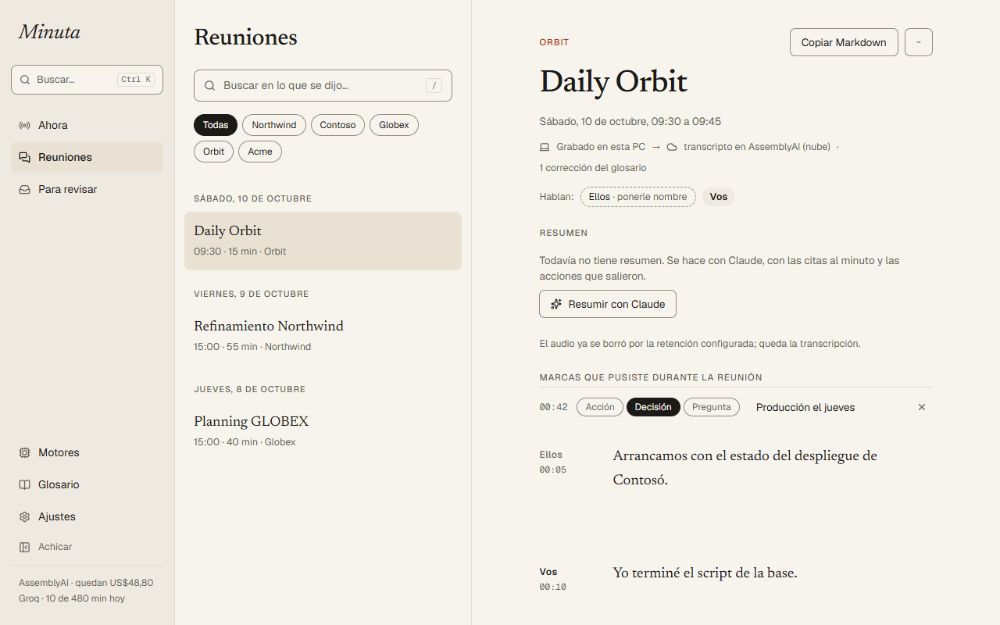
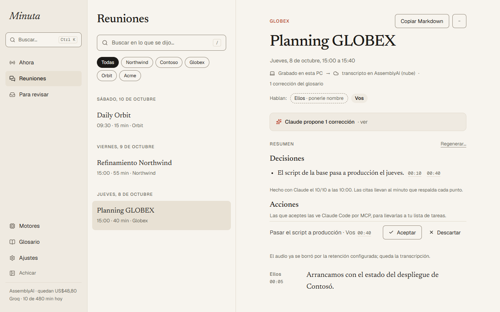
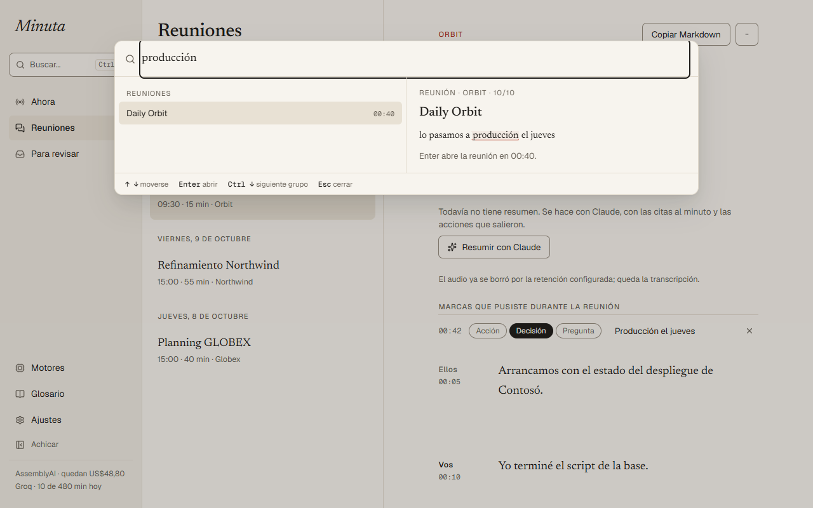
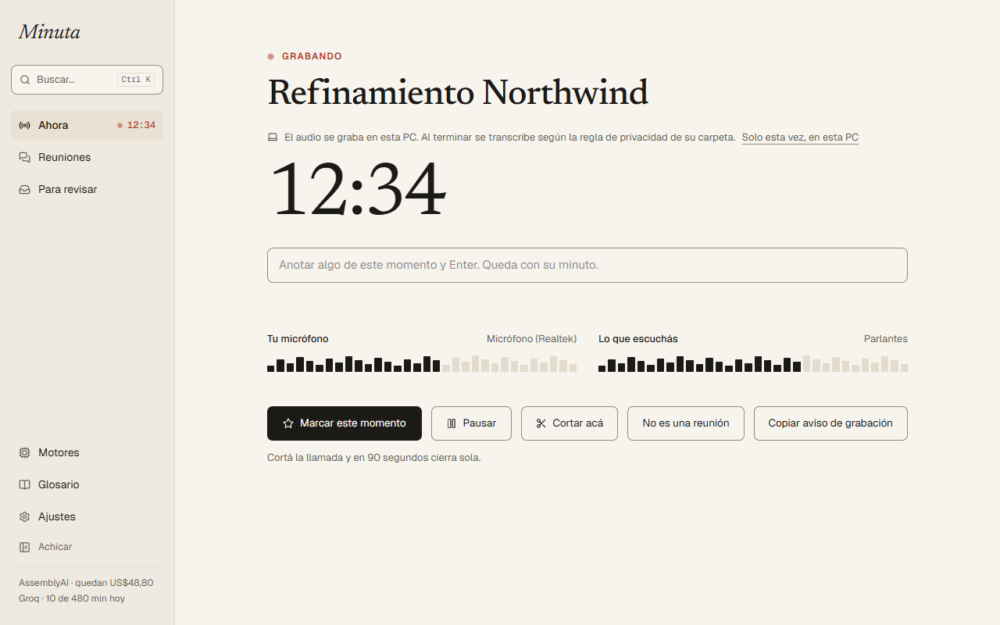

# Minuta

**A local-first meeting recorder, transcriber and searchable library for Windows.**

Minuta detects when a Teams, Meet or Slack huddle starts, records both sides of the call, transcribes it, figures out who spoke, files it in the right folder using your calendar, and keeps everything in a local library you can search, correct and summarize. It also does push-to-talk dictation anywhere in Windows.

> The UI and the code comments are in Spanish.

<p align="center">
  <br>
  <em>The library: meetings by day and folder, with the transcript and the marks you set while recording.</em>
</p>

<p align="center">
  <br>
  <em>A meeting with its Claude summary: every point links to the minute that backs it, and action items wait for your OK.</em>
</p>

<p align="center">
  <br>
  <em><code>Ctrl+K</code> searches everything that was said and jumps to that minute.</em>
</p>

<p align="center">
  <br>
  <em>Recording in progress: both channels, live levels, marks and notes with their minute.</em>
</p>

<sub>Screenshots use fictitious sample data.</sub>

## Why

Hosted meeting notetakers send every conversation to someone else's servers. Minuta keeps the audio, the transcripts and the library on your own machine:

- **Audio never leaves your PC unless you allow it.** Recordings, the SQLite library and the logs live in `%LOCALAPPDATA%`.
- **Per-folder privacy.** Each folder sets which engines it can use: a cloud engine (AssemblyAI, Groq) or only local Whisper. "Local only" meetings are never uploaded, not even for dictation.
- **No secrets in files.** API keys and private iCal URLs are stored in the Windows Credential Manager (`keyring`).
- **Works offline.** Without network or credits it falls back to local Whisper.

## Features

- **Automatic detection** of meetings (Teams web/desktop, Google Meet, Zoom, Slack huddles) from microphone sessions (WASAPI) and window titles, plus manual recording for in-person meetings.
- **Dual-channel capture**: your microphone and the system loopback, recorded as separate tracks so "me" and "them" stay apart.
- **Transcription** with AssemblyAI, Groq (Whisper large-v3) or local [faster-whisper](https://github.com/SYSTRAN/faster-whisper), resumable chunk by chunk.
- **Speaker diarization** fully on CPU with [sherpa-onnx](https://github.com/k2-fsa/sherpa-onnx) (pyannote segmentation + CAM++ embeddings), in a low-priority side process.
- **Calendar classification**: matches each recording to your iCal events to set title, participants and folder.
- **Glossary-driven correction** of names and jargon that speech models get wrong, learned from your edits.
- **Summaries, action items and pre-meeting briefs** using Claude (through the Claude Code CLI), with per-folder templates.
- **MCP server** so Claude Code and other MCP clients can search and read your meeting library.
- **Push-to-talk dictation**: hold `Ctrl+Win`, speak, release, and the text is pasted at the cursor. Clipboard history and password-manager entries are respected.
- **Full-text search** of everything that was said, from the library or with `Ctrl+K`, without AI (SQLite FTS5).

## Architecture

```
┌──────────────────────────── Minuta (Tauri 2) ────────────────────────────┐
│                                                                          │
│  React + TypeScript UI (Vite, Tailwind)        Rust shell                │
│  library · reader · settings · tray panel      supervisor (Job Object),  │
│              │                                 tray, autostart, global   │
│              │ HTTP + WebSocket (token)        shortcuts, dictation hook │
│              ▼                                                           │
│  ┌──────────────── Python engine (sidecar) ────────────────┐             │
│  │ capture (WASAPI) → job queue → transcription → diarize  │             │
│  │ calendar classification · glossary correction · SQLite  │             │
│  │ FastAPI local API (127.0.0.1)          MCP server       │◄── Claude   │
│  └─────────────────────────────────────────────────────────┘     Code    │
└──────────────────────────────────────────────────────────────────────────┘
```

| Folder | What it is |
|---|---|
| `app/` | Tauri 2 + React + TypeScript (Vite). `src-tauri/` is Rust: engine supervisor, tray, autostart, shortcuts, dictation keyboard hook |
| `motor/` | Python package `minuta`: capture, detection, job queue, transcription, diarization, classification, correction, SQLite, local API and MCP server |
| `scripts/` | Packaging (embeddable Python + deps for the installer) and measurement tools |

The engine runs inside a Windows Job Object, so if the app dies the whole process tree goes with it. The local API only listens on `127.0.0.1` and requires a per-launch token.

## Requirements

- Windows 10/11 (WASAPI capture and Win32 APIs are used directly)
- Python 3.11
- Node.js 20+ and npm
- Rust toolchain (stable) and the [Tauri 2 prerequisites](https://v2.tauri.app/start/prerequisites/) (WebView2, MSVC build tools)
- Optional: AssemblyAI and/or Groq API keys, and [Claude Code](https://docs.claude.com/en/docs/claude-code) for summaries

## Getting started

```powershell
# 1. Engine
cd motor
python -m venv .venv
.venv\Scripts\pip install -e ".[dev]"
.venv\Scripts\python -m pytest

# 2. App (development)
cd ..\app
npm install
npm run tauri dev
```

API keys and calendar URLs are added from **Settings** inside the app and go straight to the Windows Credential Manager.

### Useful environment variables

| Variable | Effect |
|---|---|
| `MINUTA_DATOS` | Data folder (database, recordings, logs). Default: `%LOCALAPPDATA%\ar.fmare.minuta` |
| `MINUTA_MIS_CORREOS` | Your own email addresses, comma-separated, so calendar matching can ignore you as a participant |
| `MINUTA_MOTOR` | Python executable to launch with `-m minuta` instead of the venv one |
| `MINUTA_MOTOR_ARGS` | Extra engine arguments, e.g. `--sin-captura` (no recording) |

### Run the UI in a browser, without recording

```powershell
cd motor; .venv\Scripts\python -m minuta --dev --sin-captura --puerto 8765
cd app;   npm run dev        # token: dev
```

### Tests

```powershell
cd motor; .venv\Scripts\python -m pytest     # engine
cd app;   npm run e2e                         # Playwright, against a simulated engine
```

### Build the installer

```powershell
cd app
npm run empaquetar   # embeddable Python engine + NSIS per-user installer
```

## Customizing

The folders, the calendar rules (`motor/minuta/clasificacion/calendarios.py`) and the starter glossary (`motor/minuta/recursos/`) ship with fictitious example companies (Acme, Globex, Contoso...). Replace them with your own.

## Models and third-party licenses

Models are **downloaded at runtime** from their original sources; none are bundled in this repository.

| Component | Used for | License |
|---|---|---|
| [faster-whisper](https://github.com/SYSTRAN/faster-whisper) and Whisper models | Local transcription | MIT |
| [sherpa-onnx](https://github.com/k2-fsa/sherpa-onnx) | Diarization runtime | Apache-2.0 |
| [pyannote segmentation-3.0](https://huggingface.co/pyannote/segmentation-3.0) (ONNX export by sherpa-onnx) | Speaker segmentation | MIT |
| [3D-Speaker CAM++](https://github.com/modelscope/3D-Speaker) | Speaker embeddings | Apache-2.0 (3D-Speaker project) |

Cloud engines (AssemblyAI, Groq) and Claude are optional and subject to their own terms. If you redistribute a built installer, review the licenses of the bundled Python dependencies (for example, PyAV ships FFmpeg libraries).

## License

[MIT](LICENSE) © 2026 Fernando Mare
